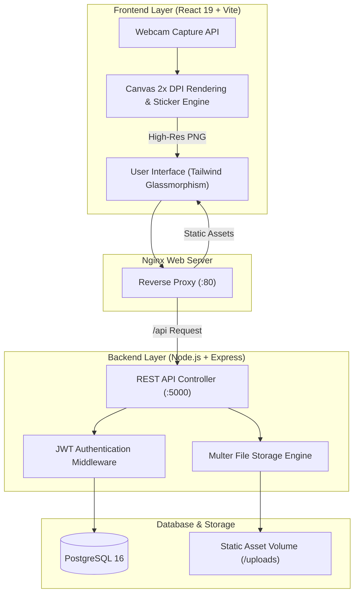

# 📸 Snappie — Cute Glassmorphism Photobooth Platform

[](https://github.com/luminariadev/snappie/actions/workflows/ci.yml)
[](LICENSE)
[](https://react.dev/)
[](https://vitejs.dev/)
[](https://tailwindcss.com/)
[](https://nodejs.org/)
[](https://www.postgresql.org/)
[](https://www.docker.com/)

Snappie adalah aplikasi photobooth berbasis web modern dengan pendekatan **User-Centered Design (UCD)** dan antarmuka **Cute Glassmorphism**. Aplikasi ini dirancang untuk studio foto interaktif, event booth, maupun penggunaan personal dengan dukungan live camera capture, kustomisasi strip foto, dekorasi stiker, filter warna, serta ekspor cetak resolusi tinggi (*High-DPI Print-Ready*).

---

## 🎨 Karakteristik Desain & Alur Pengguna (UCD)

1. **User Experience & Responsivitas**
   - Mengusung tema visual *frosted glass* (`backdrop-blur`) dengan palet pastel lembut (Sakura Pink, Lavender Mist, Baby Sky).
   - Layout sepenuhnya adaptif untuk berbagai ukuran layar (mobile, tablet, kiosk, dan desktop).

2. **Studio Capture Engine**
   - Pilihan layout strip: **1-Foto (Polaroid)**, **3-Foto (Trio Strip)**, dan **4-Foto (K-Cut Studio)**.
   - Timer countdown terkonfigurasi (3 detik, 5 detik, 10 detik) dilengkapi efek visual flash kamera dan audio chime Web Audio API.

3. **Sticker Decorator & Canvas Rendering**
   - Pengguna dapat menambahkan filter warna (Natural, Soft, Retro Film, Sepia, Monochrome).
   - Drag-and-drop dekorasi stiker langsung di atas strip foto sebelum proses ekspor.
   - Ekspor PNG menggunakan rendering Canvas 2x DPI untuk hasil cetak tajam tanpa pecah.

4. **Backoffice Admin**
   - Manajemen katalog frame dinamis (upload frame strip PNG transparan).
   - Monitoring transaksi, analitik pengunjung, dan rekap pendapatan.

---

## 🏛️ Arsitektur Sistem



---

## 📁 Struktur Direktori

```text
snappie/
├── .github/
│   └── workflows/
│       └── ci.yml               # GitHub Actions CI automated pipeline
├── backend/
│   ├── database/
│   │   └── seed.sql             # Skrip SQL inisialisasi user admin
│   ├── src/
│   │   ├── config/              # Konfigurasi koneksi database PostgreSQL
│   │   ├── controllers/         # Handler REST API
│   │   ├── middleware/          # JWT auth & upload handling
│   │   ├── models/              # Model Sequelize ORM
│   │   └── routes/              # Routing endpoint API
│   ├── .env.example             # Template konfigurasi environment backend
│   ├── Dockerfile               # Production Dockerfile untuk backend API
│   ├── package.json             # Manifest dependensi backend
│   └── server.js                # Entry point server Express
├── frontend/
│   ├── public/                  # Asset publik & frame strip default
│   ├── src/
│   │   ├── components/          # Komponen modular UI (user & admin)
│   │   ├── layouts/             # User & Admin shell layouts
│   │   ├── pages/               # Tampilan halaman utama
│   │   └── utils/               # Canvas converter & image utilities
│   ├── .env.example             # Template variabel frontend
│   ├── Dockerfile               # Multi-stage Dockerfile (Vite + Nginx)
│   ├── nginx.conf               # Konfigurasi reverse proxy Nginx
│   └── package.json             # Manifest dependensi frontend
├── .dockerignore                # Rule exclude Docker build
├── .gitignore                   # Rule exclude Git
├── docker-compose.yml           # Orkestras multi-container lokal & produksi
├── LICENSE                      # Lisensi MIT
└── README.md                    # Dokumentasi utama proyek
```

---

## ⚡ Panduan Menjalankan Aplikasi

### Opsi 1: Menggunakan Docker Compose (Direkomendasikan)

Prasyarat: Terinstal Docker dan Docker Compose.

```bash
# 1. Clone repository
git clone https://github.com/luminariadev/snappie.git
cd snappie

# 2. Salin template environment untuk backend
cp backend/.env.example backend/.env

# 3. Jalankan seluruh layanan dengan Docker Compose
docker compose up -d --build

# 4. Verifikasi status container
docker compose ps
```

Layanan dapat diakses melalui browser:
- **Frontend Web UI**: `http://localhost` (Port 80)
- **Backend REST API**: `http://localhost:5000` (Health check: `http://localhost:5000/health`)
- **PostgreSQL Database**: `localhost:5432`

---

### Opsi 2: Menjalankan Secara Manual di Lingkungan Lokal

#### 1. Persiapan Backend
```bash
cd backend
npm install
cp .env.example .env
# Sesuaikan parameter database PostgreSQL pada file .env
npm start
```

#### 2. Persiapan Frontend
```bash
cd ../frontend
npm install
npm run dev
```
Aplikasi frontend akan aktif di `http://localhost:5173`.

---

## 🔌 Dokumentasi REST API Utama

| Method | Endpoint | Deskripsi | Akses |
| :--- | :--- | :--- | :--- |
| `GET` | `/health` | Pemeriksaan kesehatan layanan (*health check*) | Publik |
| `POST` | `/api/admin/login` | Autentikasi admin & penerbitan token JWT | Publik |
| `GET` | `/api/frames` | Mengambil seluruh katalog frame foto | Publik |
| `POST` | `/api/frames` | Menambahkan frame baru (*multipart/form-data*) | Admin |
| `DELETE`| `/api/frames/:id` | Menghapus frame berdasarkan ID | Admin |
| `POST` | `/api/payment` | Inisialisasi token pembayaran transaksi | Publik |
| `GET` | `/api/admin/transactions` | Rekapitulasi transaksi pembayaran | Admin |

---

## 🧪 Pipeline CI/CD

Repository ini dilengkapi pipeline otomatis berbasis **GitHub Actions** (`.github/workflows/ci.yml`) yang melakukan pengujian setiap kali terjadi *push* atau *pull request* ke branch utama:
- Instalasi dependensi dan verifikasi build frontend via Vite.
- Verifikasi sintaks dan integritas dependensi backend Node.js.
- Validasi struktur file `docker-compose.yml`.

---

## 📄 Lisensi

Proyek ini didistribusikan di bawah lisensi **MIT**. Silakan tinjau file [`LICENSE`](LICENSE) untuk informasi lebih lanjut.

---

## 👤 Pembuat

**luminariadev**  
- GitHub: [@luminariadev](https://github.com/luminariadev)  
- Email: rizkianuari83@gmail.com
